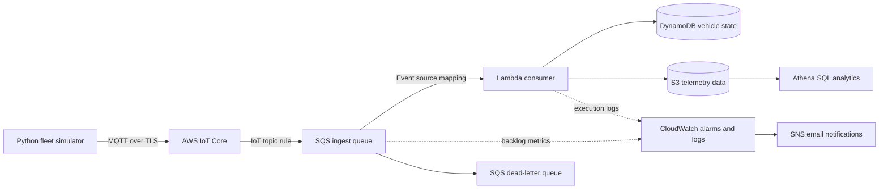

# MQTT Fleet Telemetry Pipeline

[](https://github.com/MalakLH/mqtt-fleet-pipeline/actions/workflows/ci.yml)
[](LICENSE)

An infrastructure-as-code project that simulates vehicle telemetry over MQTT and processes it through an AWS serverless pipeline, with operational monitoring and SQL analytics.

> **Status:** The pipeline and Athena queries have been tested by the author. Performance figures and experiment results are intentionally left blank until measured and recorded.

## Architecture



Architecture diagram source: [`docs/architecture.mmd`](docs/architecture.mmd).

## What it does

- Simulates multiple vehicles publishing telemetry to MQTT topics such as `fleet/car-001/telemetry`.
- Authenticates the simulator to AWS IoT Core using an X.509 device certificate.
- Routes telemetry from AWS IoT Core to SQS, buffering incoming messages before Lambda processing.
- Processes telemetry with a Lambda consumer and maintains vehicle state in DynamoDB.
- Stores telemetry in S3 for querying with Athena, where the configured table uses Parquet and partition projection.
- Uses CloudWatch logs/alarms and SNS notifications to help observe failures and queue backlog.
- Provisions AWS resources with Terraform.

**Stack:** Python · Paho MQTT · AWS IoT Core · SQS · Lambda · DynamoDB · S3 · Athena · CloudWatch · SNS · Terraform.

## Repository layout

```text
.
├── simulator/                 # MQTT vehicle telemetry generator
├── lambda/consumer/            # Lambda processing code
├── terraform/                  # Infrastructure as code
├── sql/athena.sql              # Athena table, view, and analytics queries
├── docs/
│   ├── architecture.mmd
│   └── decisions.md
├── .github/workflows/ci.yml    # CI checks without AWS credentials
└── README.md
```

Adjust this tree if your actual repository contains additional or differently named files.

## Prerequisites

- Python 3.12 or a compatible local Python version for the simulator.
- Docker only if you want to run a local Mosquitto broker for local testing.
- AWS CLI configured for the target AWS account and region.
- Terraform.
- Git and (optionally) GitHub CLI (`gh`).
- An AWS account. AWS usage can incur charges; review current pricing before deploying.

The Terraform configuration in this project has been used in `eu-north-1`. Review `terraform/terraform.tfvars` and the variables before deploying to another region.

## Configuration and secrets

Create a local `.env` file at the repository root for the simulator. Example values:

```dotenv
IOT_ENDPOINT=YOUR_AWS_IOT_DATA_ENDPOINT
LOCAL=0
VEHICLES=2
INTERVAL=2
MAX_MESSAGES=20
FAULT_RATE=0
```

Use the IoT data endpoint returned by your own deployment. For local Mosquitto testing, set `LOCAL=1` and start the local broker first.

The simulator's AWS mode expects these local files:

```text
certs/AmazonRootCA1.pem
certs/device.pem.crt
certs/private.pem.key
```

These files are credentials. Keep them local and never commit them. Do not paste private keys, certificates, `.env` values, Terraform state, or account secrets into issues or screenshots.

## Deploy

From the repository root:

```bash
terraform -chdir=terraform init
terraform -chdir=terraform validate
terraform -chdir=terraform plan
terraform -chdir=terraform apply
```

Inspect the plan before approving it. Keep the generated Terraform state and credentials private.

## Run a bounded telemetry test

Install the simulator dependencies in your virtual environment (use the project's requirements file if one exists):

```bash
pip install -r requirements
```

Run a small test from the repository root:

```bash
VEHICLES=2 INTERVAL=2 MAX_MESSAGES=20 FAULT_RATE=0 python simulator/simulate.py
```

The simulator reads configuration from `.env`. Confirm that it prints the AWS IoT Core connection message when `LOCAL=0`.

## Validate the pipeline

1. Subscribe to `fleet/+/telemetry` in the AWS IoT Core MQTT test client.
2. Check the `fleet-ingest` SQS queue metrics. Messages may be consumed quickly, so an empty queue alone does not indicate failure.
3. Inspect the Lambda consumer's CloudWatch log group for processing results and errors.
4. Explore the `vehicle_state` DynamoDB table and check that recent vehicle state is present.
5. Inspect the S3 bucket for the expected telemetry files and partition layout.
6. Run the SQL in `sql/athena.sql` in the `fleet` Athena workgroup. Replace the bucket placeholder and use a date for which data exists.

Use the actual resource names and output values from your Terraform deployment. The exact S3 prefix and schema must match the Lambda output.

## Analytics

The Athena SQL creates a database/table over the S3 data, a deduplication view for at-least-once delivery, and example queries for end-to-end latency percentiles and speeding events by zone.

Partition projection expects paths in this form:

```text
s3://YOUR_BUCKET/curated/telemetry/dt=YYYY-MM-DD/hour=HH/
```

The SQL assumes fields such as `e2e_ms`, `zone`, and `speeding` exist in the stored data. If the Lambda schema changes, update the table and queries to match.


## Design decisions

See [`docs/decisions.md`](docs/decisions.md) for the rationale and trade-offs behind the main design choices. Only describe features as implemented if you verified them in the code and tests.

## Cost and cleanup

This project is not guaranteed to cost $0. Charges depend on account eligibility, region, usage, and current AWS pricing. Potentially billable resources include provisioned DynamoDB capacity, S3 storage and requests, CloudWatch, SNS, Lambda, SQS, and Athena queries.

Cost safeguards configured in this project include an Athena workgroup scan limit and an S3 lifecycle policy, but these do not guarantee a zero bill. Check the actual Terraform configuration and AWS Billing dashboard.

When finished testing, review and run:

```bash
terraform -chdir=terraform destroy
```

Review the deletion plan before confirming. A bucket containing objects may need to be emptied first. After destruction, verify that resources were removed and review Billing and Cost Management; billing data can take time to update.

## CI

GitHub Actions runs Terraform formatting/validation and Python lint/test checks without AWS credentials. CI passing does not prove the live AWS pipeline works; live integration tests must be run separately.

## Limitations and future work

- The simulator's shared certificate is suitable only for a small demonstration; production systems should use per-device identities and certificate lifecycle management.
- SQS and Lambda provide decoupling, but duplicate delivery and retries must be handled explicitly.
- Small Parquet files can become inefficient as data volume grows; compaction would be needed at scale.
- Add load tests, dashboards, schema/version management, and stronger automated integration tests before treating this as production infrastructure.
- Possible extensions include Kinesis Data Streams for replayable streams, Firehose for managed delivery/Parquet conversion, Iceberg with compaction, and a dedicated time-series or search backend if justified by requirements.

## License

Released under the MIT License. See [`LICENSE`](LICENSE).
